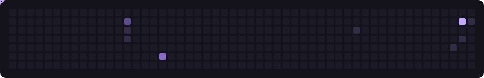
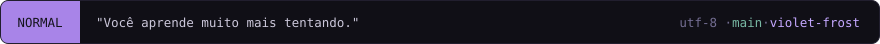

  

 

### <code>~/sobre</code>

Estudante de **Engenharia de Software** na Fametro, em Manaus. Gosto do que
roda por baixo dos panos: **APIs, arquitetura e banco de dados**. Meu projeto
mais completo até agora é o **SyncEvents**, um app Android com back-end em
Spring Boot, chat em tempo real e mais de 300 testes automatizados.

Busco minha primeira oportunidade como **estagiário ou desenvolvedor júnior**.

 

### <code>~/projetos</code>

 

### <code>~/stack</code>

| | |
|:--|:--|
| **Linguagens** |     |
| **Back-end** |     |
| **Dados** |    |
| **Mobile e web** |     |
| **Ferramentas** |     |

 

### <code>~/atividade</code>

<picture>
  <source media="(prefers-color-scheme: dark)" srcset="https://raw.githubusercontent.com/PedroLuizR/PedroLuizR/output/snake-dark.svg">
  <source media="(prefers-color-scheme: light)" srcset="https://raw.githubusercontent.com/PedroLuizR/PedroLuizR/output/snake-light.svg">
  
</picture>

 

### <code>~/certificados</code>

| Curso | Instituição | Ano |
|:--|:--|:--:|
| Framework e Criação de Sites | Fundação Bradesco | 2025 |
| Robótica na Prática | Fundação Bradesco | 2025 |
| Cibersegurança | Fundação Bradesco | 2024 |
| Programador de Sistemas e Web | Fundação Bradesco | 2024 |
| HTML, CSS e JavaScript | Fundação Bradesco | 2024 |

 

