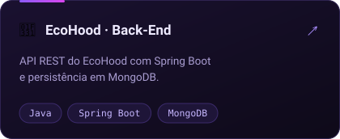
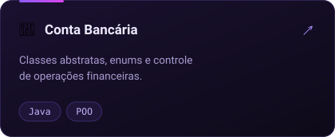
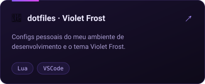

 

 

## ◆ Sobre mim

- 🎓 Estudante de **Engenharia de Software** na **Fametro** — Manaus/AM
- ⚙️ Foco em **back-end**: lógica, arquitetura, banco de dados e as APIs que sustentam tudo
- 🌱 No momento: construindo o **EcoHood** (Spring Boot + MongoDB) e aprofundando em **TypeScript**
- 🤝 Buscando minha primeira oportunidade como **estagiário ou desenvolvedor júnior**

 

## ◆ Tecnologias

**Back-end & dados** 

**Front-end & linguagens** 

**Ferramentas** 

 

## ◆ Projetos em destaque

 

## ◆ Estatísticas

 

## ◆ Certificações

| | Curso | Instituição | Ano |
|:--:|:--|:--|:--:|
| 🌐 | Framework e Criação de Sites | Fundação Bradesco | 2025 |
| 🤖 | Robótica na Prática | Fundação Bradesco | 2025 |
| 🔐 | Cibersegurança | Fundação Bradesco | 2024 |
| 💻 | Programador de Sistemas e Web | Fundação Bradesco | 2024 |
| 📝 | HTML, CSS e JavaScript | Fundação Bradesco | 2024 |

 

