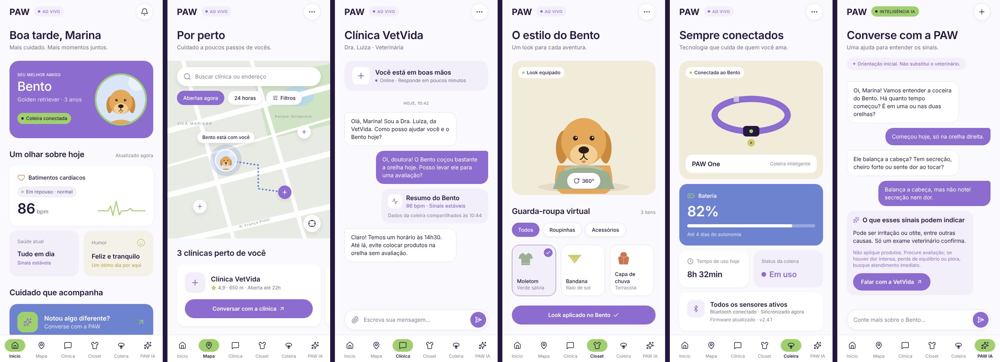

# PAW 🐾

App mobile de cuidado para pets: saúde do cachorro via **coleira inteligente**, **clínicas por perto**, **chat com a clínica**, **closet virtual** e **assistente de IA**. Interface em pt-BR.



## Stack
Expo SDK 58 · React Native · TypeScript (strict) · expo-router (tabs) · lucide-react-native · Inter · react-native-svg.

**Fase atual:** front-end com dados mockados (sem back-end, BLE ou IA real).

## Rodando
```bash
npm install
npx expo start          # Android / iOS (Expo Go) ou "w" para web
npm run typecheck
```

## Estrutura
```
app/                    rotas (expo-router)
  _layout.tsx           fontes Inter, SafeArea, StatusBar
  (tabs)/               Início, Mapa, Clínica, Closet, Coleira, PAW IA
src/
  theme/tokens.ts       cores, tipografia, espaçamentos, raios, tamanhos
  components/           AppHeader, Badge, Card, Chip, PrimaryButton, Chat*, BottomTabBar…
  features/             uma pasta por tela (home, map, clinic, closet, collar, ai)
  data/mock.ts          todos os dados mock
  hooks/                usePet, useCollar, useClinics, useChat
  services/ai.ts        sendMessage(history) → Promise<string> (mock, pronto para API real)
assets/images/          bento_avatar.png, bento_closet.png, coleira_paw_one.png
```

## Notas
- As imagens em `assets/images/` são **ilustrações provisórias**. Substitua pelos recortes do Figma mantendo os mesmos nomes.
- O mapa é um SVG ilustrado isolado em `src/features/map/MapView.tsx`; para trocar por `react-native-maps`, mude só esse arquivo.
- O aviso “Não substitui o veterinário” fica fora da lista do chat da PAW IA, então está sempre visível.
